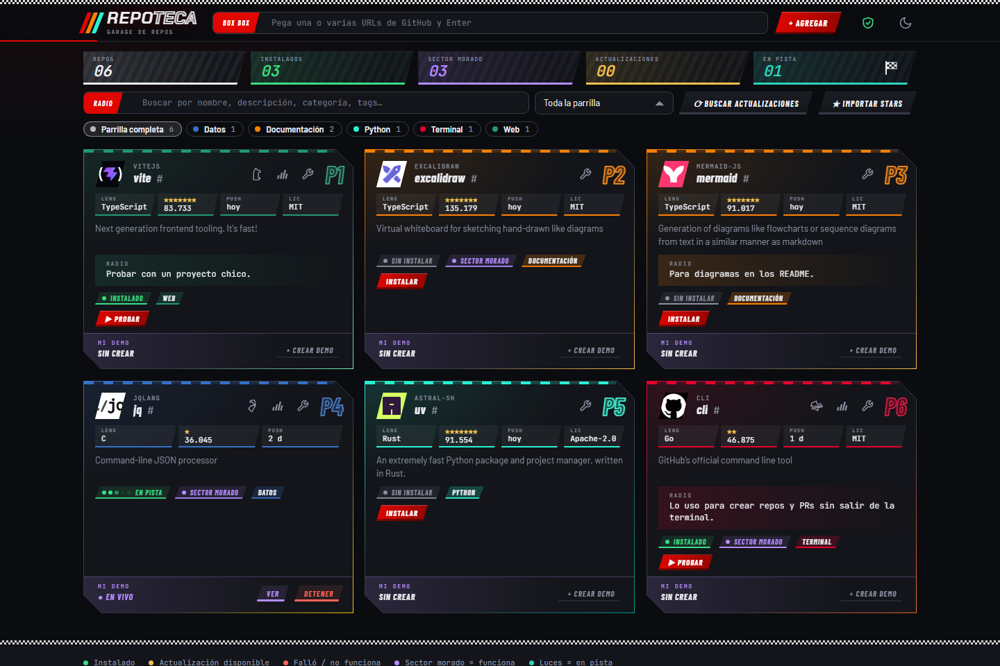

**[English]** · [(En español más abajo)](#español)

# Repoteca

[](https://github.com/awarefractal/repoteca/actions/workflows/ci.yml)
[](https://github.com/awarefractal/repoteca/actions/workflows/codeql.yml)
[](LICENSE)
[](https://nodejs.org)
[](package.json)

**A garage for your GitHub repos.** Keep them cataloged, installed, tried out and up to date in one place, instead of scattered all over your disk.

Paste a GitHub URL, and Repoteca indexes it, installs it on demand, runs it so you can try it right away, tells you when it has new commits, and keeps your own notes and demos next to it. Everything is local, with zero dependencies and no database (the catalog is a readable JSON file).

License: [MIT](LICENSE) · Needs [Node.js 20+](https://nodejs.org) and [git](https://git-scm.com)



> The web UI is currently in Spanish. The code, API and MCP tools are easy to follow; translations are welcome.

## Quick start

```bash
git clone https://github.com/awarefractal/repoteca.git
cd repoteca
npm start
```

No `npm install` needed: there are no dependencies. On Windows you can also double-click `start.cmd`. The UI opens at `http://localhost:4747` (set `PORT` to change it). It always runs on your own machine.

## What it does

- **Catalog:** paste one or many GitHub URLs. Metadata (description, stars, language, license, topics) comes from the public GitHub API. Add your own category, tags, notes and a verdict (`sin-probar` / `funciona` / `no-funciona`, i.e. untested / works / broken).
- **Install / Try / Update:** clones the repo, launches it and shows it in a side panel, and updates with `git pull --ff-only`.
- **Safe mode (on by default):** cloning does not run anything from the repo. Before `npm install`, `pip install` and the like, Repoteca shows the exact command and folder and waits for your confirmation. The shield in the header turns it off if you prefer one-click installs.
- **Check for updates:** compares the local commit with GitHub for the whole catalog.
- **Copy local path:** every installed repo has a small F1 circuit icon next to its other buttons (each repo gets its own track). Click it to copy the repo's local path to the clipboard, ready to paste into Claude Code, to start a project, to hand to another AI assistant, or to open in your editor.
- **My demo:** your own quick test of each repo, kept outside the clone so updates never overwrite it.
- **Search:** by name, description, category, tag, language or notes.
- **Claude Code / MCP:** the same data is exposed through an MCP server, so you can say "add https://github.com/…", "what do I have about AI?", "install and try X".

## Use it from Claude Code (MCP)

Open this folder in Claude Code: `.mcp.json` registers the `repoteca` server (approve it the first time). From another folder:

```bash
claude mcp add repoteca --scope user -- node /path/to/repoteca/src/mcp.mjs
```

The UI and the MCP server share the same data.

## Where your data lives

One folder, `data/` (git-ignored; move it with the `REPOTECA_DATA` environment variable). To back up or move your catalog to another machine, copy that folder.

| What | Where |
| --- | --- |
| Catalog (readable JSON) | `data/catalog.json` |
| Clones installed by Repoteca | `data/repos/owner__name/` |
| Your demos | `data/demos/owner__name/` |
| Logs and job state | `data/logs/`, `data/jobs/` |

A repo you already cloned elsewhere can be registered **in place** (`installPath` field, via `add_repos` in the MCP). It is never moved or duplicated, and Repoteca never deletes folders it did not install.

## My demo

`data/demos/owner__name/index.html` is served as is. If you need to run something, add a `demo.json`:

```json
{ "run": "node test.js" }
```

The command runs inside the demo folder and receives `REPO_DIR` (the installed repo) and `PORT` (the port to listen on, if it is a server).

## Details

- **How it installs and runs things:** detects Node (`npm|pnpm|yarn`, `dev` or `start` script), Python (`requirements.txt` / `pyproject.toml` in a `.venv`; runs `app.py` / `main.py`), Rust, Go and static HTML. If it guesses wrong, set the commands by hand in the edit dialog. `installCmd: "-"` means "never reinstall".
- **Rate limits:** the GitHub API allows 60 requests/hour without a token. Set `GITHUB_TOKEN` for more, and for private repos.
- **Privacy:** no telemetry. The only network calls are to the GitHub API, to `git` remotes, and to Google Fonts / GitHub avatars when the UI loads in your browser.

## Security

Installing and running **executes third-party code on your machine** (`npm install` scripts, build steps, the repo itself). Review what you install. Safe mode makes you confirm the install command before it runs, but it cannot tell you whether the code is trustworthy. The server listens only on `127.0.0.1` and rejects requests that do not come from its own UI. Do not expose its port to a network. See [SECURITY.md](SECURITY.md) for details and how to report a vulnerability.

## Contributing

Issues and pull requests are welcome. Keep it dependency-free: the logic lives in `src/core.mjs`, and `server.mjs` (UI) and `mcp.mjs` are thin layers on top of it. See [CONTRIBUTING.md](CONTRIBUTING.md) and the [Code of Conduct](CODE_OF_CONDUCT.md).

## License

[MIT](LICENSE). A courtesy Spanish translation is in [LICENSE.es.md](LICENSE.es.md); the English text is the one that applies. Third-party material (the F1 circuit outlines) is credited in [THIRD_PARTY_NOTICES.md](THIRD_PARTY_NOTICES.md).

---

# Español

**Un garage para tus repos de GitHub.** Tenlos catalogados, instalados, probados y al día en un solo lugar, en vez de desparramados por el disco.

Pega una URL de GitHub y Repoteca la indexa, la instala cuando quieras, la ejecuta para que la pruebes al instante, te avisa si tiene commits nuevos y guarda tus notas y tus demos junto a ella. Todo corre en local, sin dependencias y sin base de datos (el catálogo es un JSON legible).

Licencia: [MIT](LICENSE) · Requiere [Node.js 20+](https://nodejs.org) y [git](https://git-scm.com)

> La interfaz web está en español. El código, la API y las herramientas MCP son fáciles de seguir; las traducciones son bienvenidas.

## Instalar (desde cero)

```bash
git clone https://github.com/awarefractal/repoteca.git
cd repoteca
npm start
```

Sin `npm install`: no tiene dependencias. En Windows también sirve el doble clic a `start.cmd`. Se abre `http://localhost:4747` (otro puerto: variable `PORT`). Corre siempre en tu equipo; para "dejarlo disponible" basta con dejar abierta esa ventana o crear un acceso directo a `start.cmd`.

## Usarla

Pega una o varias URLs de GitHub y Enter. Cada card tiene:

- **Instalar** (clona; el **modo seguro**, activo por defecto, no ejecuta nada del repo al clonar y, antes de `npm install`, `pip install` y similares, te muestra el comando exacto y la carpeta y espera tu confirmación; el escudo de la cabecera lo desactiva), **Probar** (levanta el repo y lo muestra en el panel lateral), **Actualizar** y **Editar** (llave de mecánico: categoría, tags, notas, veredicto, comandos, **Desinstalar** y **Eliminar**; el ícono de terminal abre la telemetría).
- **Mi demo:** tu propia prueba del repo. **Crear demo** arma una carpeta con una plantilla; la editas (o le pides a Claude que la arme) y **Ver demo** la muestra en vivo. Detalles abajo.
- **Copiar ruta local:** cada repo instalado tiene un pequeño icono de circuito de F1 junto a sus otros botones (cada repo tiene su propia pista). Al hacer clic se copia al portapapeles la ruta local del repo, lista para pegarla en Claude Code y crear un proyecto, pasársela a otra IA o abrirla en tu editor.
- "Buscar actualizaciones" consulta GitHub por cambios en todo el catálogo.

## Usarla desde Claude Code

Abre esta carpeta en Claude Code: `.mcp.json` registra el servidor `repoteca` (apruébalo la primera vez). Luego basta con "agrega https://github.com/…", "qué tengo de IA", "instala y prueba X", "arma mi demo de X". Desde otra carpeta:

```bash
claude mcp add repoteca --scope user -- node /ruta/a/repoteca/src/mcp.mjs
```

La UI y Claude comparten los mismos datos.

## Dónde queda todo

Una sola carpeta, `data/` (ignorada por git; muévela con la variable `REPOTECA_DATA`). Para respaldar o pasar tu catálogo a otro equipo, copia esa carpeta.

| Qué | Dónde |
| --- | --- |
| Catálogo (JSON legible) | `data/catalog.json` |
| Clones instalados por Repoteca | `data/repos/owner__name/` |
| Tus demos | `data/demos/owner__name/` (fuera del clon: actualizar nunca las pisa) |
| Registros y estado de trabajos | `data/logs/`, `data/jobs/` |

Un repo que ya tenías clonado en otra carpeta se registra **en su sitio** (campo `installPath`, vía Claude con `add_repos` + `installPath`): no se mueve ni se duplica, y Repoteca nunca borra carpetas que no instaló.

## Mi demo

`data/demos/owner__name/index.html` se sirve solo. Si necesitas ejecutar algo, agrega `demo.json`:

```json
{ "run": "node prueba.js" }
```

El comando corre en la carpeta de la demo y recibe `REPO_DIR` (el repo instalado) y `PORT` (el puerto donde debe escuchar si es un servidor).

## Detalles

- **Cómo instala/prueba:** detecta Node (`npm|pnpm|yarn`, script `dev` o `start`), Python (`requirements.txt`/`pyproject.toml` en un `.venv`; prueba `app.py`/`main.py`), Rust, Go y HTML estático. Si no acierta, defínelo en Editar. En `installCmd`, `-` significa "no reinstalar nunca".
- **Actualizaciones:** compara el commit local con el de GitHub; "Actualizar" hace `git pull --ff-only` y reinstala.
- **Metadatos:** API pública de GitHub (60 consultas/hora sin token). Define `GITHUB_TOKEN` para más cupo y repos privados.
- **Privacidad:** sin telemetría. Las únicas conexiones son a la API de GitHub, a los remotos de `git` y, al cargar la UI en tu navegador, a Google Fonts y a los avatares de GitHub.

## Seguridad

Instalar y probar **ejecuta código de terceros en tu equipo** (scripts de `npm install`, etc.). Revisa lo que instalas. El modo seguro te hace confirmar el comando de instalación antes de ejecutarlo, pero no puede decirte si el código es de fiar. El servidor solo escucha en `127.0.0.1` y rechaza peticiones que no vengan de su propia UI. No expongas su puerto a una red. Mira [SECURITY.md](SECURITY.md) para el detalle y cómo reportar una vulnerabilidad.

## Contribuir

Los issues y pull requests son bienvenidos. Mantenlo sin dependencias: la lógica vive en `src/core.mjs`, y `server.mjs` (UI) y `mcp.mjs` son capas finas encima. Mira [CONTRIBUTING.md](CONTRIBUTING.md) y el [Código de Conducta](CODE_OF_CONDUCT.md).

## Licencia

[MIT](LICENSE). Hay una traducción de cortesía al español en [LICENSE.es.md](LICENSE.es.md); el texto que rige es el inglés. El material de terceros (los contornos de circuitos de F1) tiene sus créditos en [THIRD_PARTY_NOTICES.md](THIRD_PARTY_NOTICES.md).
